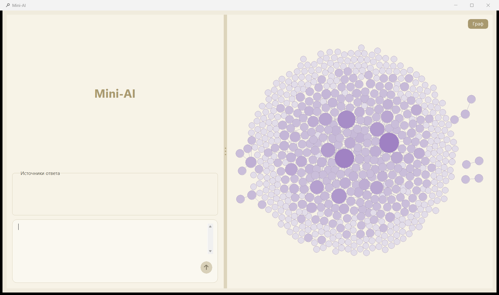
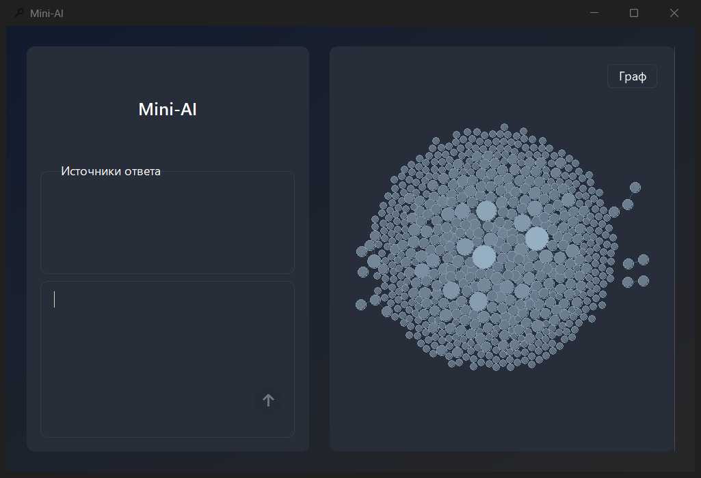
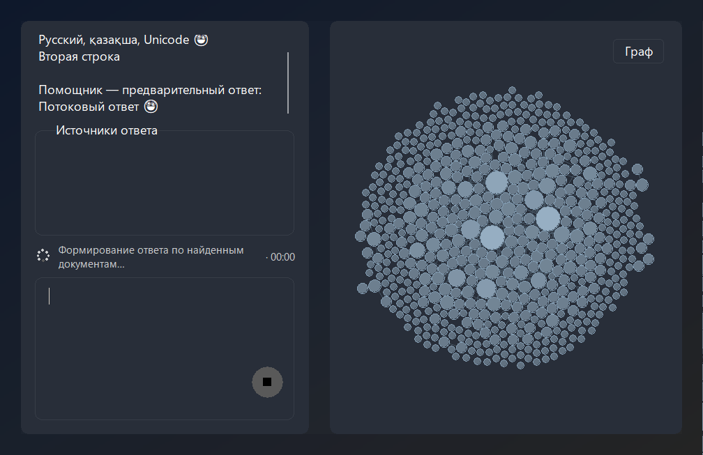

# Mini-AI — структура и оформление Autonomy&Performance

> 4 ноября 2026 года устаревшие бинарные копии, включая `src/build/restyle-backup/Mini-AI.exe`, удалены при согласованной очистке. Текущий EXE, исходники, изображения и компактные отчёты сохранены. Подробности: [src/STORAGE-CLEANUP.md](src/STORAGE-CLEANUP.md).

Зафиксировано 21 октября 2026 года. Визуальный эталон нового оформления — актуальный проект `Autonomy&Performance`; типы и расположение элементов Mini-AI сохраняются.

- Основное окно содержит горизонтальный перетаскиваемый разделитель: помощник слева, граф справа, начальное соотношение 45/55.
- В верхней гибкой области помощника находится история: нативный SWT `Text`, только чтение, перенос строк, выделение и копирование. При пустой истории показывается отдельная центральная надпись Mini-AI.
- Ниже расположен постоянный округлый блок «Источники ответа». Внутри — прокручиваемые ссылки и подписи с точными привязками источников.
- Над вводом во время запроса показываются индикатор, этап обработки и время ожидания. В состоянии покоя эта строка исключена из раскладки.
- Внизу помощника находится нативный многострочный редактируемый `Text`, Unicode-ввод, Enter для отправки и Shift+Enter для новой строки. Справа внизу — одна круглая доступная кнопка: стрелка отправки либо квадрат остановки.
- Граф остаётся Canvas: масштаб колесом, перемещение камеры, выделение и перетаскивание узлов, открытие документов. Кнопка «Граф» расположена поверх Canvas в правом верхнем углу.
- Карточка источника содержит выделяемый текст происхождения, предупреждение и действие открытия оригинала. Ошибки выводятся в принадлежащих приложению диалогах.

Исходный снимок получен с полного локального `Mini-AI.exe` через наблюдатель принадлежащего процессу HWND. Отчёт и SHA-256 EXE: `src/build/test-results/restyle-before-native.json`. Снимок целостности документов, базы и модели: `src/build/test-results/restyle-data-before.json` (исходные файлы читаются без изменений; инструменты конвертера `_runtime` и кеши исключены).

Новое самостоятельное окно запускается и ограничивается минимумом 820×560 DIP с системным масштабом Windows. Встраиваемый компонент сохраняет управление размерами за вызывающим приложением.

## Новое оформление

Перенесены тёмные поверхности, диагональный сине-серый фон, системный акцент, состояния контролов и типографика основы: Segoe UI Variable Text с резервным Segoe UI, основной размер 14 DIP, подписи 12 DIP, заголовок 20 DIP. Внешние отступы и промежуток между панелями — 24 DIP, внутренние отступы — 16 DIP; радиусы панелей 8 DIP, обычных кнопок 4 DIP. В графе сохранена выразительность степени узлов, изменена только палитра и оформление его панели.

Настоящий Mica виден во внешних отступах окна. Карточки и нативные текстовые поля непрозрачны; при недоступности DWM используется тот же градиент поверх сплошного фона. Прозрачность и высокая контрастность Windows не переключаются приложением.

История, ввод, источники и подробности источника используют общий контроллер: 36 DIP на шаг колеса, сглаживание 75 мс и пружина `k=300`, затухание `24`, предел ±18 DIP. Сохраняются дробные движения колеса. Полоса занимает постоянную зону 20 DIP; индикатор расширяется с 2 до 6 DIP. Нативные SWT Text, ввод, выделение, копирование, каретка и доступность сохранены; колесо над графом по-прежнему управляет масштабом графа.

## Проверка локальной сборки от 21 октября 2026 года

- Статический EXE собран командой `src/build.ps1 -Action build -Profile static`, после проверки скопирован в корень проекта. Размер — **315 863 040 байт**, SHA-256 — `0696b9c09f531757d611655fcc426871906135487566d9e1e9c9a33b5f246f08`.
- Итоговая матрица интерфейса: **90 проверок на каждом из масштабов 100/125/150/200%**, все пройдены. Запуск: `src/tests/visual/verify-restyle.ps1`. Все случаи сначала регистрируют полный каталог семи модулей. Для проверки потока ответа и ошибок затем используются управляемые тестовые сервисы помощника и открытия источника.
- Проверены минимальная и увеличенная раскладки, Unicode, Enter/Shift+Enter, отправка/остановка, потоковый текст, источники и диалоги; оба края пружины, дробное колесо над Text/Link/полосой, разворот, ручная прокрутка, каретка, стационарное выделение за краем, изменение размеров и закрытие.
- Точный локальный EXE прошёл нативный `--ui-smoke` с кодом 0 и без stderr. Нативное окно при DPI 120 занимает 1025×701 пиксель: ширина 820 DIP, высота 560 DIP с округлением рамки до одного физического пикселя. Иконка и новая палитра подтверждены снимком принадлежащего процессу окна.
- `--status` из корня проекта подтверждает семь модулей и обе панели без ошибок регистрации; `--model-status` распознаёт имеющуюся llama.cpp/Q6_K модель. Полный ответ настоящей модели для этой задачи не проверялся.
- Mica проверена в одном полном окне сравнением DWM `2 → 1 → 2`: изменились 3418 пикселей внешнего отступа, после восстановления различий 0. Цвета градиента проверены отдельно от композитора.
- Проверка статических импортов и разрешения исходного документа пройдена. По SHA-256 и размеру сохранены все **7907 файлов** документов, базы и модели; исключены только каталоги `_runtime`, `__pycache__`, `.git`. Проверки отсутствующих модулей и отдельные функциональные испытания графа не запускались.

Локальные отчёты: `src/build/test-results/restyle-ui-{100,125,150,200}.json`, `restyle-final-native.json`, `restyle-mica-compositor.json`, `restyle-source-gate.json`, `restyle-data-integrity.json`. Они относятся к выполненным сценариям; полной проверки IME и трассировки файловых/реестровых операций не проводилось. Предыдущий EXE сохранён в `src/build/restyle-backup/Mini-AI.exe`. Публикация релиза не выполнялась.
