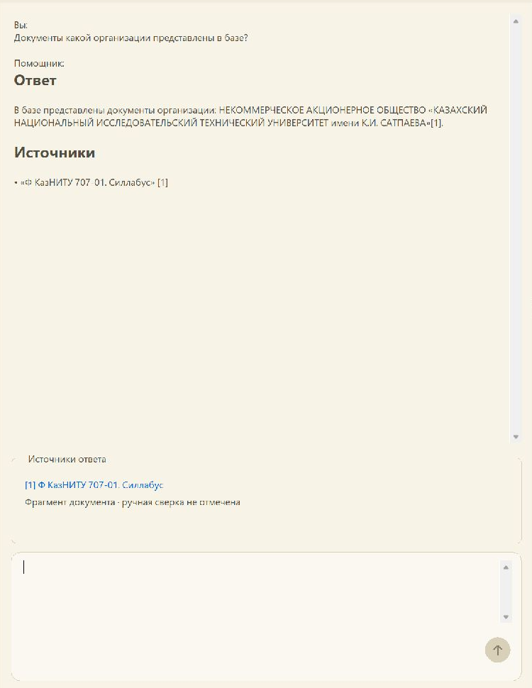
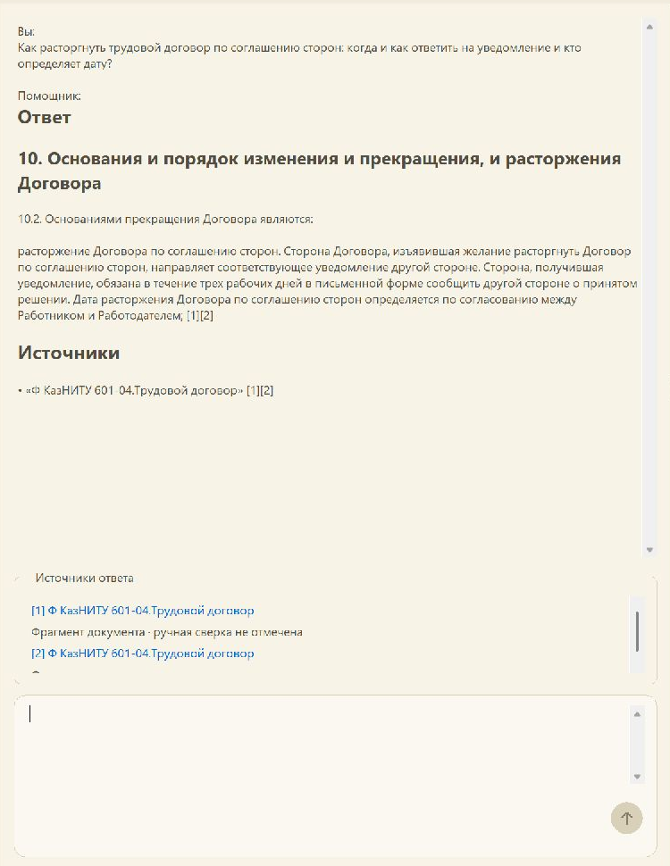

# Mini-AI: локальный помощник, обучение и проверяемые основания

**Исследовательская работа завершена по решению пользователя. Пользовательская приёмка качества отмечена пройденной по его прямому указанию. Автоматическая итоговая приёмка не подтверждена: новый закрытый набор 120 вопросов и 10 практических заданий не выполнялся.** Пользовательское решение не меняет сохранённые метрики и обнаруженные ошибки.

## 1. Цель и исходное состояние

Задача состояла в создании локального помощника, которому можно задать обычный вопрос по университетским документам и получить необходимую информацию: действие, адресата, срок, условия и исключения. Для просьбы «составь заявление» полезным результатом должен быть редактируемый проект, а не набор похожих выдержек. Источники должны открываться и позволять проверить происхождение ответа. Отдельное требование — работа на ноутбуке без обязательной облачной генерации и системной установки.

Исследование использовало Windows 11, примерно 32 ГБ RAM и **RTX 4090 Laptop с 16 ГБ VRAM**, а не настольную карту с 24 ГБ. Основной генератор — Qwen3.5-4B Q6_K. Каноническая SQLite содержала **599 документов и 106 139 фрагментов**. Это объём базы поиска, не объём обучения. Исходный лексический поиск плохо переносил обычные формулировки; существование ссылки не обеспечивало полноту или применимость ответа.

Старый опубликованный [комплект версии 1](https://github.com/MarkZamore/Mini-AI/releases/tag/v2026.10.24-local-ai), его отчёт и архив сохранены. Проверялись только полные конфигурации приложения с семью модулями; сокращённые сборки, отдельные испытания графа и Process Monitor не использовались.

## 2. Причины ошибок и выбранная архитектура

Обнаружились три разных источника неудач. Поиск мог не найти нужную норму, особенно при казахском вопросе к русскому документу. Найденное основание могло быть неполным: без соседнего условия, адресата или продолжения списка. Наконец, модель могла правильно процитировать текст, но применить его к другой категории либо выдать длинную подборку вместо ответа.

Архитектура объединяет лексический и семантический поиск, собирает связанные основания, выбирает режим ответа и показывает проверяемые ссылки. В нормативной части приложение использует целые канонические положения; предлагаемый пользователю черновик отделяется от требований источника. Точное название организации извлекается из проверенного тела документа без дополнительного вызова генератора. Для checklist применяется детерминированное оформление; модельное группирование других заданий ограничивается ссылками на исходные единицы.

**Цитата существует ≠ цитата подтверждает утверждение ≠ ответ полезен.** Проверки идентификаторов и целостности обеспечивают происхождение, но не доказывают правильное сопоставление столбцов, ролей или ситуаций. Автоматический перевод нормативных выдержек отклонён: он менял смысл и увеличивал ожидание. Сохраняется исходный текст, а пригодность проекта на языке вопроса оценивается отдельно.

## 3. Данные и защита от подгонки

Фактический исходный train включал **91 намерение: 61 RU и 30 KZ, 17 семейств документов**. Распределение было узким: 54 намерения относились к одному семейству договора обучения работника; 27 из 30 казахских — к той же теме. Поэтому нельзя утверждать, что все 599 документов равномерно участвовали в обучении. Большинство заданий просило извлечь положение из названного документа, что проще свободного вопроса без подсказки.

Источники автоматически сверялись с исходными XML и локаторами. Такая сверка доказывает наличие текста, но не полноту нормативного эталона. Семейства документов, редакции и связанные намерения рассматривались совместно. Поздний аудит обнаружил три близкие демонстрационные формы, пропущенные фильтром названий; этот недостаток сохранён в материалах, а не объявлен отсутствующим.

Старые final100/challenge34 стали известными диагностическими наборами. Для версии 2 зарезервированы целые 49 семейств и 54 документа; закрытые вопросы и эталоны не использовались для разработки. **Новый закрытый тест остался неисполненным**, поэтому результат версии 2 нельзя назвать подтверждённой независимой итоговой оценкой. Метки и рецензии автоматические; человека-эксперта, независимо принявшего все ответы, не было.

## 4. Как обучалась E5

Первой изменялась multilingual-e5-small — модель поиска, превращающая вопрос и фрагмент в нормированные векторы из 384 чисел. Входы различались префиксами `query:` и `passage:`. Обучающий пример содержал вопрос, положительное основание и отрицательного кандидата. В ordinary отрицательный текст выбирался из другого обучающего документа и семейства; в hard — по наибольшему лексическому сходству. Другой ID сам по себе не гарантирует смысловую отрицательность: независимой проверки каждого hard negative не было.

**Полный fine-tuning E5 делал обучаемыми все 117 653 760 параметров.** Использовалась InfoNCE: правильный кандидат должен получать преимущество по косинусной близости перед отрицательным, температура — 0,05. Это сравнение двух кандидатов в конкретной реализации, а не доказанное обучение со множеством положительных оснований. AdamW обновлял веса при LR `2e-5`, weight decay `0.01`; BF16, длина 256 токенов, накопление четырёх примеров дали 23 optimizer steps за один проход. Ordinary повторён вторым seed; hard — отдельный вариант той же архитектуры.

После изменения encoder заново вычислялись векторы корпуса. **Индексация не считается обучением весов**: она создаёт производные данные для выбранной модели. E5 экспортирована в ONNX; проверены токенизация и численная близость. SHA encoder и корпуса привязаны к индексу. Предел 256 токенов означает, что длинный источник не представлен целиком одним embedding, поэтому сбор соседних условий остаётся отдельной задачей. [Конфигурации, доказательства изменений и экспорт](appendices/Как_обучалась_модель.md).

## 5. Как обучались генераторы

Для 4B использовалась **QLoRA: исходная NF4-основа заморожена, обучаются 16 232 448 параметров адаптеров rank 8, alpha 16**. Четырёхбитное хранение экономит память; вычисления выполнялись BF16. Rank — размерность добавляемой поправки, а не число новых слоёв. Полный AdamW для всей 4B исключён из быстрого маршрута из-за памяти.

Функция потерь — causal cross-entropy только на токенах ответа: модель не обучалась воспроизводить вопрос и весь контекст. AdamW использовал LR `1e-4`, накопление 13, один проход из 201 контекстного задания и 16 обновлений. Варианты A/B имели те же 91 намерение и бюджет целевых токенов; B добавлял отвлекающие, перемешанные и ограниченные основания. **201 строка не означает 201 независимую ситуацию.** Старые targets в основном обучали извлечению и ссылкам, а не полноценному составлению заявлений.

Кандидат A объединён с основой и преобразован в согласованный Q6_K GGUF. Обычный промежуточный экспорт с другим составом тензоров отвергнут; принят matched-контейнер с 426 тензорами, исходным tokenizer/header, 248 изменёнными проекциями и 178 совпавшими необученными тензорами. B и компактный опыт не выдаются за готовые поставленные GGUF.

В отдельной **0.8B partial FT** изменялись базовые веса последних четырёх текстовых блоков 20–23: 83 018 720 параметров, 53 изменённых тензора. Embeddings, vision и остальные блоки заморожены. Использовались BF16 autocast, AdamW, LR `2e-5` и 16 шагов. Этот фактический LR отличается от первоначального предложения; сравнения скоростей обучения не было. Это обновление части основы, не LoRA. Разницу между 0.8B и 4B нельзя приписать дообучению.

## 6. Воспроизводимость и пределы технической проверки

Сохранялись веса, optimizer, scheduler, порядок данных и RNG; SHA подтверждают реальные изменения. CPU round-trip у A/B восстановил optimizer и случайные состояния, но не доказал побитово одинаковый следующий CUDA-шаг. Перед генераторным обучением использовались примеры 365/408 токенов, хотя максимальный вход достигал 983: **требование предварительной проверки на настоящей максимальной длине не подтверждено**. Завершённый проход не исправляет это задним числом.

Для сравнения генератора фиксировались одинаковые найденные контексты, decoding и квантование. Для сравнения поиска менялись E5 и соответствующий индекс; различие найденных контекстов здесь ожидаемое следствие encoder, а генератор оставался тем же. Групповой bootstrap пересчитывал парные разности по целым семействам, сохраняя зависимые намерения. Интервал, включающий ноль, обозначается как неподтверждённое преимущество. Малое число семейств и однообразные вопросы ограничивают перенос выводов.

## 7. Что показали эксперименты

| Изменение | Измерение | Фактический вывод |
|---|---|---|
| E5 ordinary FT | Старый frozen100: actual-context Recall@10 56% → 95%; Δ39 п.п., семейный CI [12,24; 52,42] | **Подтверждён профильный выигрыш поиска известных оснований**, не accuracy ответов |
| E5 в полном ответе | Старый source-linked challenge: консервативно 6/28 против 6/28, CI разности [−20; +25]; критические случаи 3 против 4 | Надёжность не улучшилась доказанно; прежняя поставка сохранила исходную E5 |
| 4B QLoRA A | Одинаковые контексты RAG20: буквальный показатель 6/20 → 10/20, CI [−15; +60] | Преимущество не подтверждено; у A зарегистрирован цикл 83 повторов |
| 0.8B partial FT | Проверочная ошибка предсказания уменьшилась | Это не доказательство качества полного помощника |

Семантика старых 100 случаев осталась `unknown` из-за недостаточного эталона; машинный ноль нельзя назвать фактической точностью 0%. В challenge у обоих вариантов 19/30 неопределённых случаев. Hard и второй seed уточняли устойчивость поиска, но не устраняли ограниченность данных. Все неудачные варианты сохранены. [Подробные сравнения и первичные артефакты](appendices/Как_обучалась_модель.md).

## 8. Классические методы и отклонённые ветви

На CPU действительно обучены логистическая регрессия и неглубокий gradient boosting для выбора `answer/clarify/insufficient`, сравнённые с правилами. Было 30 случаев, 23 доступных при работе признака и четыре групповых folds. Правильные атомы и gold-ответ не являлись признаками; масштабирование настраивалось внутри train-fold. Macro-F1: правила 0,817, регрессия 0,915, бустинг 0,814. Интервал выигрыша регрессии включил ноль; всего четыре случая уточнения не обеспечили export gate. **Оба классификатора отклонены для подключения**, несмотря на сохранённые обученные коэффициенты и деревья. [Методика и веса](appendices/Классические_модели_режима_ответа.md).

Переписывание KZ-запросов улучшало отдельные попадания, но меняло операцию «рассматривается» на «записывается»; холодный rewrite+search занял 19,594 с ещё до ответа. [Метод отклонён](evidence/finalization/query-rewrite-review.json). Пилот «название + текст» получил 0/6 нужных связей в top‑10 ограниченного oracle-пула; [полный reindex не запускался](evidence/finalization/representation-summary.json). Удаление 217 пустых записей сохранило 105 922 оставшихся вектора побайтно, однако KZ-пропуски плана преподавателя остались. [Это исправление дефекта](evidence/finalization/nonblank-diagnosis.json), а не доказанный смысловой выигрыш.

Новый M2 SFT **не выполнялся**. Двенадцать source-free action-заготовок не стали принятым учебным набором. Все 17 source-кандидатов оказались заголовками, колонтитулами либо пунктуацией: [пригодных targets — ноль](evidence/finalization/M2-source-gate.md). Предварительный протокол остановлен до весовых обновлений; старые citation-targets не подменяли action-gold. По решению пользователя новые исследования прекращены.

## 9. Последние фактические результаты версии 2

Автоматическое перечитывание открытых v15 ordinary28 дало RU **42/42**, KZ **25/42** поддержанных обязательных атомов; KZ также 16 missing и 1 unknown. Доставлено 39 релевантных единиц из 55 — **70,9%**; прямой ответ первым в 20/28. Все объявленные факты поддержаны в 21/28, однако это лишь потолок необходимой полноты: применимость и полезность могут уменьшить результат. Подтверждённых критических утверждений в этом разборе не обнаружено; отсутствие обнаружения не означает нулевой риск.

В трёх выбранных текстовых заданиях строгий результат **0/3**, в шести reference-задачах — **0/6** полностью полезных ответов. Арифметика отдельно **2/2**. Цитаты могли быть точными, но ответ не давал нужной таблицы, смешивал категории или оставался подборкой текста. Эти поднаборы не объединяются в общую accuracy. В открытом v13 поиске ordinary70/84 против foundation61/84 дали Δ10,71 п.п., но семейный CI [0; 27,94] включил ноль. Это диагностические, неоднократно использованные вопросы. [Разбор v15](evidence/finalization/v15-ordinary-summary.json), [парные интервалы v13](evidence/finalization/paired-retrieval-v13-bootstrap-v1/summary.md).

Медиана/p95 первого пользовательского текста v15 — **3,094/6,771 с** в полном JVM-сервисе. По сравнению с v14 ускорение не установлено; это не native GUI и не измерение звонка Teams. Быстрый отказ или неполный ответ не считается выигрышем скорости. В прежней отдельной CPU-проверке одного запроса первый/полный текст заняли 174,865/203,585 с; этот единичный замер не переносится на все ноутбуки и не заменяет p95.

## 10. Приёмка, демонстрация и применение

**Пользовательская приёмка пройдена по прямому решению пользователя.** Автоматические содержательные критерии, абсолютная цель 80%, требуемый прирост и независимая проверка новой версии не подтверждены. Отчёт фиксирует завершённый исследовательский результат с известными ограничениями; не обозначает невыполненный закрытый тест успешным и не гарантирует правильность любого нормативного ответа.

Для операционного комплекта принято решение использовать исходную 4B Q6_K и исходную E5 с совместимым индексом как более простой контроль при неподтверждённом общем выигрыше дообучения. Это выбор сохранённой конфигурации, а не победитель нового закрытого теста. Метрики v15 ordinary относятся к исследовательскому кандидату с обученной E5 и не приписываются этому контролю.

Два результата **после** получены в настоящем максимизированном AOT-приложении `final-v16-foundation-searchable`. Это известные демонстрационные темы, не слепая проверка и не сравнение одинаковых исторических запусков.

**Организация.** Вопрос: «Документы какой организации представлены в базе?» Приложение показало полное название:

> НЕКОММЕРЧЕСКОЕ АКЦИОНЕРНОЕ ОБЩЕСТВО «КАЗАХСКИЙ НАЦИОНАЛЬНЫЙ ИССЛЕДОВАТЕЛЬСКИЙ ТЕХНИЧЕСКИЙ УНИВЕРСИТЕТ имени К.И. САТПАЕВА».

Название связано с источником «Ф КазНИТУ 707-01. Силлабус». Карточка источника реально открыта и закрыта; внешний просмотр оригинала не проверялся. [Полный текст](final/after-01.txt), [запись интерфейса](final/after-01.json).

**Расторжение договора.** Вопрос: «Как расторгнуть трудовой договор по соглашению сторон: когда и как ответить на уведомление и кто определяет дату?» В ответе из «Ф КазНИТУ 601-04.Трудовой договор» сохранено:

> Сторона, получившая уведомление, обязана в течение трех рабочих дней в письменной форме сообщить другой стороне о принятом решении. Дата расторжения Договора по соглашению сторон определяется по согласованию между Работником и Работодателем;

Отображены две ссылки на основания и предшествующий контекст уведомления. Это ответ в области данного документа, не заключение об актуальности всех правил трудового права. [Полный текст](final/after-02.txt), [запись интерфейса](final/after-02.json).

Оба снимка — реальные изображения; [манифест](final/screenshot-manifest.json) сохраняет SHA оригиналов и точную обрезку без изменения пикселей. Служебная отметка об отсутствии ручной сверки не скрыта. Точный TTFT не измерялся: во втором диалоге готового ответа не наблюдалось к 35,321 с, полный ответ зафиксирован к 83,294 с. Это редкие наблюдения, не точная задержка первого текста и не доказательство ускорения. Teams был открыт; настоящий звонок не проверялся.

В том же приложении проверены отмена активного поиска и следующий запрос: после «Генерация отменена» расчёт 15% от 48 000 вернул 7 200. [Функциональный протокол](final/gui-checks.json). Дополнительные демонстрационные снимки не создавались.

Другой корпус требует проверки схемы, стабильных идентификаторов базы/документа/фрагмента, source refs, версии содержимого, построения совместимого индекса и своей содержательной оценки. Работа на удержанной теме одной университетской базы не доказывает перенос на любую организацию. Названия и правила нельзя зашивать вместо чтения источников; новый диалог должен быть привязан к активной базе.

## 11. Сохранение и воспроизведение

В [подробном приложении](appendices/Как_обучалась_модель.md) приведены реальные команды, revisions, функции потерь, trainable/frozen параметры, checkpoints, экспорты и SHA; [инвентарь](evidence/training-v1/copy-inventory.json) связывает небольшие доказательные копии с оригиналами. Веса и корпус на Desktop не дублируются. Подготовлены отдельные [выступление](Выступление_Как_я_обучил_модель.md) и [короткий результат](Текущий_результат.md).

Финальная полная AOT-сборка v16 завершилась с exit0. Её конфигурация — `final-v16-foundation-searchable`, EXE SHA-256 `471cd062408efb135bd0c08465131a297dd9dfeadcd986e164a8057efa2f790b`; согласованный runtime содержит 6811 файлов. Это технический результат сборки с исходными 4B и E5; качество закрытым тестом не принималось. [Результат сборки](evidence/finalization/AOT-v16-built-handoff.md), [решение поставки и SHA](evidence/finalization/release-authority-v16.json).

Комплект: [выпуск v2026.10.24-final](https://github.com/MarkZamore/Mini-AI/releases/tag/v2026.10.24-final). Обновление и отдельная полная проверка установки офлайн прошли для всех **6811 файлов**; это проверка состава, SHA и установки, не дополнительная генерация или оценка качества. [Квитанция](evidence/finalization/offline-installer-v16-verification.json). Установочный профиль по умолчанию — CPU; CUDA-профиль и результаты демонстрации учитываются отдельно. Публичная доступность страницы не является частью локальной проверки установки.

Финальный комплект установлен в корень проекта: `C:\Users\Oskar\Documents\Mini-AI\Mini-AI.exe`. Атомарное обновление сохранило резервную копию; полный VerifyOnly завершился с exit0 для всех 6811 файлов. По умолчанию установлен CPU-профиль, отдельно предусмотрен NVIDIA/CUDA-профиль. [Проверка готового корня](evidence/finalization/final-v16-root-verification.json). Это подтверждение установки и целостности, а не новый содержательный тест.

Рабочий комплект сохраняется согласованно: **приложение + веса + индекс + библиотеки и настройки**. Один checkpoint или файл модели не заменяет комплект. Производные индексы нельзя смешивать с другим encoder; наличие CUDA указывает на доступность вычислений, а не на смысловую правильность. Реальный вклад работы — выполненное обучение нескольких компонентов, проверяемое происхождение оснований, честный отбор вариантов и сохранённые отрицательные результаты. **Окончательное пользовательское принятие не стирает эти научные ограничения.**
